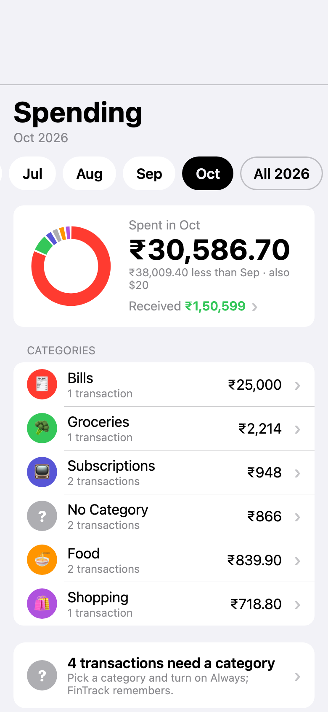
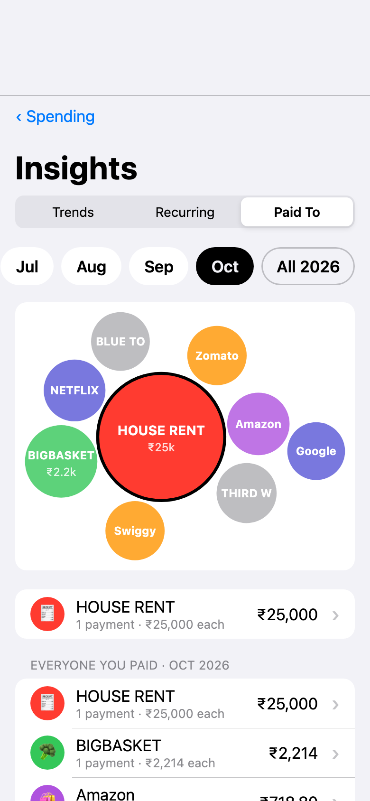
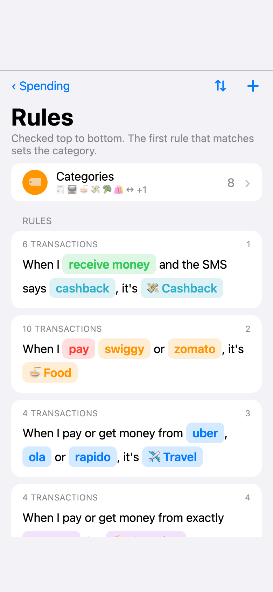
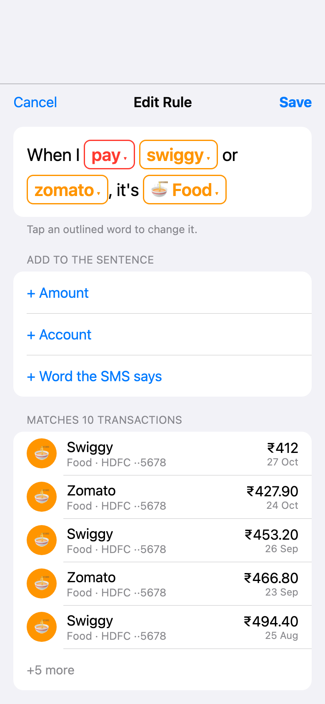

# fintrack_scriptable

Private household money tracking on iPhone, built on [Scriptable](https://scriptable.app). Bank SMS become transactions; rules put them in categories; a dashboard shows spending, trends and recurring payments. India: INR, Indian banks, UPI.

- No third party sees the data: no bank logins, no account aggregator, no server, no network calls except `FinTrack Update` downloading code from this repo.
- **Code lives here; data never does.** All data is JSON in Scriptable's iCloud folder on the phone, under `fintrack/data/`.

## Screenshots

Made-up data, from `dashboard/preview.html`.

| Spending | Insights: Paid To | Rules | Editing a rule |
|---|---|---|---|
|  |  |  |  |

## Contents

- [Screenshots](#screenshots)
- [What gets installed](#what-gets-installed)
- [One-time iPhone setup](#one-time-iphone-setup)
- [Updating](#updating)
- [Using it](#using-it)
- [How it works](#how-it-works)
- [Code map](#code-map)
- [Data files](#data-files)
- [Supported SMS](#supported-sms)
- [Project rules](#project-rules)
- [Tests](#tests)
- [Open work](#open-work)

## What gets installed

| Scriptable script | What it does |
|---|---|
| `FinTrack Update` | Downloads the latest code from this repo (files listed in `manifest.json`). Never touches `fintrack/data/`. |
| `FinTrack SMS` | Run by a Shortcuts message automation. Parses the SMS, saves it, posts a notification. No network. |
| `FinTrack` | Opens the dashboard. Also works as a widget showing this month's spend. |

Library code goes to `fintrack/lib/` and the dashboard to `fintrack/dashboard/` inside Scriptable's folder.

## One-time iPhone setup

1. **Install.** In Safari on the iPhone, open [`scripts/FinTrack Update.js` (raw)](https://raw.githubusercontent.com/jonathanvevance/fintrack_scriptable/master/scripts/FinTrack%20Update.js), select all, copy. In Scriptable tap **+**, paste, rename the script to exactly `FinTrack Update`, tap **Done**, then run it. `FinTrack` and `FinTrack SMS` appear in the list.
2. **Try it.** Copy any bank SMS from Messages, run `FinTrack`, go to **More** and tap **Add SMS from Clipboard**.
3. **Automate.** Shortcuts → **Automation** → **+** → **Message**:
   - **Message Contains**: `debited` (leave Sender empty) → **Run Immediately** → **Next**.
   - **New Blank Automation** → add action **Scriptable → Run Script** → Script: `FinTrack SMS`.
   - Tap **Parameter** → **Shortcut Input**, then tap the inserted variable and choose **Content**. Leave **Run In App** off.
   - Repeat for `credited`, `spent` (SBI card), `used at` (HSBC card) and `paid from` (HSBC UPI payments). One keyword per automation. An SMS that matches two of them is saved once.
   - If an automation sometimes doesn't fire, check that iOS isn't filtering bank senders (Settings → Apps → Messages → Unknown Senders). Missed SMS can always be added with **More → Add SMS from Clipboard**.
4. **Widget (optional).** Add a Scriptable widget to the Home Screen, long-press → **Edit Widget** → Script: `FinTrack`.

## Updating

Push to `master`, then on the phone run `FinTrack Update` (or tap **More → Update FinTrack** in `FinTrack`).

## Using it

Tabs in `FinTrack`:

- **Spending.** Swipe the month pills, or pick **All YYYY** for the whole year with a bar per month. Shows total spent, a **Received** line that opens what came in, spend per category and the latest transactions. Tap a transaction to set its category.
- **Insights.** **Trends**: one category's line over 6 or 12 months against its average. **Recurring**: payments spotted automatically, coming up and paid this month. **Paid To**: bubbles sized by spend, for a month or a year.
- **Rules.** Each rule is one sentence with its match count, such as "When I pay swiggy or zomato, it's 🍜 Food". Rules are checked top to bottom and the first match sets the category.
  - **Add:** tap **＋**, or open a transaction, pick a category and turn on **Always**.
  - **Edit:** tap a rule. Its sentence shows outlined parts (pay / receive money, names, amount, account, a word the SMS says, the category); tap one to change or remove it in a sheet, and add missing parts from **Add to the sentence**. A name matches part of the bank's name unless the rule says **exactly**.
  - **Reorder:** tap **⇅**, drag the **≡** handles, tap **⇅** again to save (or **Cancel**).
  - **Categories** (row at the top): every category, where you can rename one, change its icon, see and add the rules that set it, merge it into another or delete it. **New Category** takes a name, an emoji and a colour. The icon picker offers a few emoji that fit the name (Pets: 🐾 🐶 🐱 🦴 🐟), the emoji your categories already use, and **Any emoji…** for anything on the keyboard.
  - A catch-all rule such as "When I receive money, it's Received" works if it is the last rule.
- **More.** My Accounts, Add SMS from Clipboard, Unrecognised Messages, Update FinTrack, version.

**Self transfers** move money between your own accounts, so they count as neither spent nor received. List your banks under **More → My Accounts**: one row per bank; a bank's page lists its account (optional) and its cards, each with its own page.

- An account has its UPI IDs and **Names shown when paid** (the name another bank's SMS shows when you pay it, such as SBI's "trf to A KUMAR").
- A card has the name its bill payment shows as in your bank's SMS.
- A transaction is a self transfer when it is paid to or received from one of your UPI IDs or names (the whole name, any capitals); when it is a NEFT naming one of your accounts by bank and last digits ("SBIN ··4321"); when it is paid to a name containing a card's bill name; or when it is a card's own bill-paid SMS.
- For a rare case the app cannot detect, open the transaction, tap **••• → Mark as Self Transfer**. This changes only that transaction and can be changed back to a payment.
- Self transfers are left out of every total, category, Insights view and the widget. They still appear in See All with a two-account icon, and opening one says why it matched.

Foreign-currency card spends are kept separate from the INR total.

## How it works

1. **Capture.** A Shortcuts automation passes the SMS text to `FinTrack SMS`, which calls `lib/capture.js`: `lib/parse.js` turns it into a transaction, `lib/store.js` saves it in that month's file. The same SMS text within 2 minutes is a duplicate (two automations matched it). If saving fails, the SMS is kept in `fintrack-pending.json` (Scriptable's local folder) and saved the next time `FinTrack` opens.
2. **Parse.** `parseSms` tries each template in `TEMPLATES` (exact bank wordings, `confidence: "high"`), then a generic parser (`confidence: "low"`, shown as "check"). Messages that are not transactions (OTPs, reminders, future debits) are ignored; ones it can't read go to Unrecognised Messages. Each time `FinTrack` opens, it re-parses the current month's low-confidence transactions, so a new template fixes old entries.
3. **Tag.** On display, `lib/tags.js` gives each transaction a category (a category set by hand beats rules), and `lib/accounts.js` marks self transfers, which get no category. Stored transactions are never rewritten by rules.
4. **Show.** `FinTrack` (`lib/dashboard.js`) opens `dashboard/` in a WebView, with every month, the rules, categories, accounts and unrecognised messages handed in directly. `lib/tags.js`, `lib/format.js` and `lib/accounts.js` are inlined into the page as `FT.tags`, `FT.format` and `FT.accounts`, so the page and Scriptable use the same code.
5. **Save.** The page cannot write files. It asks Scriptable by navigating to `fintrack://do?data=<{ action, ... }>`; Scriptable cancels the navigation, validates the request, writes the file and replies through `fintrack.reply(result)`. Saved changes show an alert with **Undo**.

## Code map

| Path | What it is |
|---|---|
| `scripts/FinTrack.js` | Entry point: dashboard in the app, this month's spend as a widget. |
| `scripts/FinTrack SMS.js` | Entry point for Shortcuts: one SMS in, notification out. If the libs fail, it writes the pending file itself, without them. |
| `scripts/FinTrack Update.js` | Self-updating installer; writes only the files in `manifest.json`. |
| `manifest.json` | Files `FinTrack Update` installs. Add new files here. |
| `lib/parse.js` | SMS → transaction. `TEMPLATES` (one per bank wording), the generic parser, date and amount parsing. No Scriptable APIs. |
| `lib/capture.js` | `capture(sms)` and `recheck(ym)`, shared by `FinTrack SMS` and Add SMS from Clipboard. |
| `lib/store.js` | Reading and writing everything under `fintrack/data/`, duplicate check, pending file, corrupt-file handling. |
| `lib/tags.js` | Rule format, `compileRules`, `tagsFor` / `tagAll`, rule sentences (`ruleSentence`, `describeRule`). |
| `lib/accounts.js` | My Accounts format, `checkAccounts`, `compileAccounts` (self-transfer matcher), card bill-paid templates. |
| `lib/format.js` | Money (Indian digit grouping), dates, month labels. |
| `lib/dashboard.js` | Builds the page, runs the WebView, handles the page's requests. |
| `dashboard/app.js` | The whole UI: state, views per screen, actions, drag to reorder. Plain JavaScript, no framework. |
| `dashboard/style.css` | iOS-style look. |
| `dashboard/index.html` | Page shell used by `lib/dashboard.js`. |
| `dashboard/preview.html` | The page with fake data for working on a laptop; requests are logged to the console and answered with fake replies. |
| `rules.example.json` | Sample rules. |
| `tests/run.js` | Unit tests (parse, tags, accounts, format, store logic). |
| `tests/page/` | Page tests that drive `preview.html` in headless Chrome. |

## Data files

All under `fintrack/data/` in Scriptable's iCloud folder. Written only by Scriptable; never in this repo; never touched by updates. A file that cannot be read is never overwritten: it is copied to `*.corrupt-<time>.json` and FinTrack shows the error.

| File | Contents |
|---|---|
| `transactions/YYYY-MM.json` | Array of transactions for that month (below). |
| `rules.json` | Array of rules: `{ "when": { … }, "set": { "category": "Food" } }`. Conditions: `merchant` and `text` (regex, any case), `direction` (`"in"` / `"out"`), `minAmount` / `maxAmount` (rupees), `account`, `bank`, `template`, `currency`. All must hold. Format in `lib/tags.js`. |
| `categories.json` | `{ "Food": { "emoji": "🍜", "colour": "#ff9500" }, … }`. Categories without an entry get a look suggested from their name. |
| `accounts.json` | `[{ "bank": "HSBC", "account": { "last4", "name", "upi": [], "names": [] } or null, "cards": [{ "last4", "name", "bills": [] }] }]`. Format in `lib/accounts.js`. |
| `unparsed.json` | SMS that no template or the generic parser could read. |

A transaction:

```json
{
  "id": "hash of SMS + capture time",
  "textHash": "hash of SMS",
  "template": "sbi-upi-debit",
  "confidence": "high",
  "bank": "SBI",
  "accountType": "bank",
  "account": "4321",
  "merchant": "SWIGGY",
  "currency": "INR",
  "amountPaise": -25000,
  "date": "2026-10-27",
  "ref": "630012345678",
  "raw": "the SMS text",
  "capturedAt": "2026-10-27T09:15:00.000Z",
  "manual": { "category": "Food" }
}
```

Money is integer paise; negative is money out. `manual` holds what was set by hand and is optional. Six categories are always offered: Food, Groceries, Shopping, Travel, Bills, Subscriptions.

## Supported SMS

Templates in `lib/parse.js` (`TEMPLATES`, tried in order; the id is saved as `template`):

| Id | SMS |
|---|---|
| `hsbc-cc-spend` | HSBC credit card used at …, any currency |
| `hsbc-account-paid` | HSBC account paid to … (UPI) |
| `hsbc-upi-credit` | HSBC account credited by UPI |
| `hsbc-neft-out` | HSBC NEFT sent |
| `hsbc-neft-in` | HSBC NEFT / IMPS / RTGS received |
| `hsbc-card-payment` | HSBC card bill paid from an HSBC account (self transfer) |
| `sbi-upi-debit` | SBI UPI debit ("trf to …") |
| `sbi-cc-spend` | SBI card spent at … |
| `sbi-cc-cashback` | SBI Cashback card cashback credited |
| `sbi-cc-payment` | SBI Card payment received (self transfer) |
| `icici-upi-debit` | ICICI account debited, payee credited (UPI) |
| `icici-account-debit` | ICICI account debited towards … |
| `hdfc-cc-payment` | HDFC card payment received (self transfer) |
| `generic` | Anything else with an amount and debited / credited / spent / paid / received; `confidence: "low"` |

**Adding a template:** copy the SMS from **More → Unrecognised Messages** (tap it, or **Copy All for Review**), replace every number and name with made-up ones, add a template to `TEMPLATES` before `generic` and a case to `tests/run.js`. A bill-paid template also goes in `CARD_BILL_TEMPLATES` in `lib/accounts.js`. Dates without a year ("26OCT") take the year from when the SMS arrived.

## Project rules

For anyone (or any AI) changing this repo:

- **Never commit personal data.** No real names, account or card digits, UPI IDs, phone numbers, amounts or SMS copied as-is. Templates stay generic; tests and `preview.html` use made-up values.
- **Updates never write under `fintrack/data/`.** Only Scriptable writes data, and only through `lib/store.js`.
- **Self transfers are never guessed.** Only exact templates and accounts the user lists in My Accounts.
- **SMS templates stay in `lib/parse.js`.** Parsing has no Scriptable APIs so it runs in plain JavaScriptCore.
- **Rules and categories are data**, never code. Rules only set a category.
- **New files the phone needs go in `manifest.json`.**
- Wording in the app says "Paid to" / "Received from", never "debit" / "credit".

## Tests

```bash
# Unit tests (plain JavaScriptCore, no install needed)
/System/Library/Frameworks/JavaScriptCore.framework/Versions/Current/Helpers/jsc tests/run.js

# Page tests (headless Google Chrome): all, or by name
zsh tests/page/run.sh
zsh tests/page/run.sh rules-reorder
```

Each page test is a script loaded into `dashboard/preview.html`. It clicks through the page, checks what it shows and what it sends to Scriptable, and writes PASS / FAIL lines to `data-result` on `<body>`. Add one by copying an existing file in `tests/page/`.

## Open work

- SMS not yet covered: money received by UPI into SBI; Zerodha from SBI (UPI AutoPay, UPI or NEFT/IMPS), and whether Zerodha's own SMS would count an investment twice; refunds or reversals on cards; SBI card spend in a foreign currency; other incoming NEFT/IMPS into SBI.
- Later: refunds reducing spend, a kind per transaction (spend, investment, …), tracking interest received.
